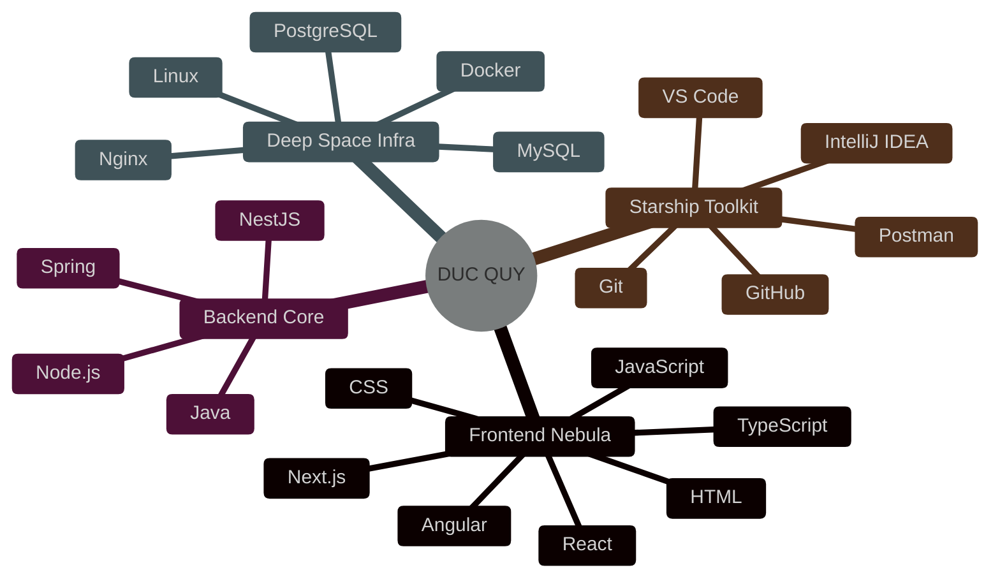
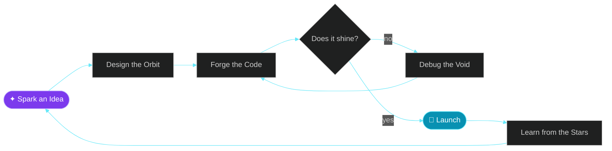

<div align="center">

```text
 ·  ˚   ✦      .        ·     ✧    .      ˚    ·     ✦    .   ·    ˚
      .    ·       ✧       .        ·   ✦         .      ·     ✧
  ✧     ·     .       ·     ✦    ·       .    ˚       ·     .     ·
 .      ✦   ·      ˚     .       ·    ✧      .   ·        ✦     .
        ·       ______   _   _   ____      ___  _   _ __   __
   ✧          |  _ \ | | | | / ___|    / _ \| | | |\ \ / /       ·
  ·    .      | | | || | | || |       | | | | | | | \ V /    ✦
     ✦        | |_| || |_| || |___    | |_| | |_| |  | |   .
 .         ˚  |____/  \___/  \____|    \__\_\\___/   |_|        ✧
   ·     .        ·     ✧      .     ·       ✦      .      ·
 ˚      ✧    .       ·     ✦     ·      .       ·     ˚    .    ·
```

### ✦ ━━━━━━  W A N D E R E R · O F · T H E · D I G I T A L · C O S M O S  ━━━━━━ ✦

`SIGNAL: STABLE` · `ORBIT: EARTH / VIETNAM` · `CLASS: SOFTWARE DEVELOPER` · `CURIOSITY: ∞`

</div>

<br/>

> [!NOTE]
> *In the silence between two stars, a new idea is born.* ✦

## 🔭 The Observer

```text
 ╔══════════════════════════════════════════════════════════╗
 ║  ░░ DECRYPTING TRANSMISSION ░░░░░░░░░░░░░░░░░░░ 100%    ║
 ╠══════════════════════════════════════════════════════════╣
 ║   ENTITY   ▸  Duc Quy                                    ║
 ║   CLASS    ▸  Software Developer                         ║
 ║   ORIGIN   ▸  Earth · Vietnam                            ║
 ║   QUEST    ▸  Turn ideas into living software            ║
 ║   POWER    ▸  Curiosity  ∞                               ║
 ║   STATUS   ▸  Exploring · Building · Never stopping      ║
 ╚══════════════════════════════════════════════════════════╝
```

$$\lim_{t \to \infty} \text{Knowledge}(t) = \infty \qquad \Longleftarrow \qquad \text{Curiosity} > 0$$

<details>
<summary><b>🜂 Unseal the hidden scroll</b></summary>

```js
const cosmos = {
  prophecy: "One more commit, one more star ignited",
  rituals:  ["learn", "build", "break", "fix", "repeat"],
  fuel:     ["coffee", "late nights", "stubborn curiosity"],
  isDone()  { return false; }   // the journey has no end
};
```

</details>

---

## 🪐 Constellation Map



## ⚡ Power Levels

| Orbit | Technologies | Affinity |
|:--|:--|:--|
| 🌌 **Frontend Nebula** | `HTML` `CSS` `JS` `TS` `React` `Next.js` `Angular` | `████████░░` |
| ☄️ **Backend Core** | `Java` `Spring` `Node.js` `NestJS` | `████████░░` |
| 🌑 **Deep Space Infra** | `MySQL` `PostgreSQL` `Linux` `Docker` `Nginx` | `███████░░░` |
| 🚀 **Starship Toolkit** | `Git` `GitHub` `VS Code` `IDEA` `Postman` | `█████████░` |

---

## 🌀 Orbit of Creation



## 📈 Mission Log

```diff
+ [DONE]   Ignite curiosity
+ [DONE]   Learn the language of machines
! [ACTIVE] Build meaningful software
! [ACTIVE] Explore new technologies
- [NEVER]  Stop learning
```

---

## 📡 Open a Channel

```text
 ┌──────────────────────────────────────────────────────┐
 │  TRANSMIT ▸ choose a frequency                       │
 └──────────────────────────────────────────────────────┘
```

| Frequency | Link |
|:--|:--|
| 🟦 **Facebook** | [facebook.com/ducquy.7Ro](https://www.facebook.com/ducquy.7Ro/) |
| 🟪 **Instagram** | [instagram.com/duc.quyyy7](https://www.instagram.com/duc.quyyy7/) |
| ⬛ **GitHub** | [github.com/LuongDucQuy](https://github.com/LuongDucQuy) |

<div align="center">

```text
 ·   ✦    .      ˚    ·     ✧    .    ·      ˚    ✦    .    ·
          The universe is infinite.
          So is the potential of curiosity.
 .    ·     ✧    ˚      .     ✦     ·    .      ✧    ·    ˚
```

✦ *Written in starlight · Compiled with curiosity* ✦

</div>
